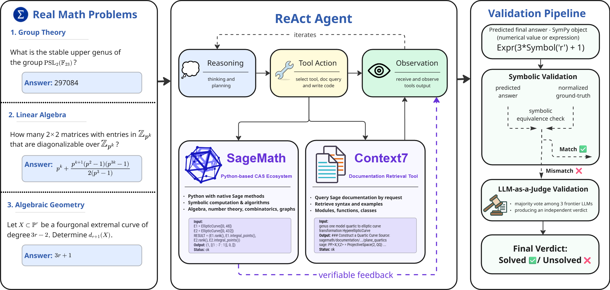

# Evaluating SageMath-Augmented LLM Agents for Computational and Experimental Mathematics

Code, data, and model outputs for the paper. We evaluate a ReAct-style agent that solves research-level math problems by interleaving reasoning with SageMath execution and SageMath documentation retrieval (Context7), and compare it with direct, tool-free answers from the same models.



- **Benchmark:** 133 problems with numerical (60) or symbolic-expression (73) answers from 88 arXiv papers, derived from [RealMath](https://arxiv.org/abs/2505.12575).
- **Models:** 20 frontier model configurations, each evaluated once per problem in both conditions: 5,320 outcomes.
- **Scoring:** a SymPy equivalence check against the normalized reference; answers it rejects go to a panel of three LLM judges (majority vote).

Everything needed to recompute the paper's numbers is included: all model answers, tool traces, checker decisions, and individual judge votes. Reproducing the analyses needs no API keys or Docker.

## Results

Solve rates aggregated over 20 configurations × 133 problems:

| Scoring | Tool-free | Sage workflow | Gain |
|---|---:|---:|---:|
| Hybrid (symbolic + judges) | 54.7% (1,456 / 2,660) | 62.9% (1,673 / 2,660) | +8.2 pp |
| Symbolic only | 38.9% (1,034 / 2,660) | 41.5% (1,103 / 2,660) | +2.6 pp |

Per configuration (hybrid solve rate, %). † marks gains significant after Holm correction across the 20 exact paired McNemar tests.

| Model | Tool-free | Sage workflow | Gain (pp) |
|---|---:|---:|---:|
| GPT-5.6 Sol | 71.4 | 75.9 | +4.5 |
| GPT-5.5 | 67.7 | 75.2 | +7.5 |
| Opus 4.8 | 66.2 | 73.7 | +7.5 |
| Fugu-Ultra | 66.9 | 72.9 | +6.0 |
| Opus 4.7 † | 61.7 | 72.9 | +11.3 |
| Gemini 3.1 Pro | 66.9 | 69.9 | +3.0 |
| Qwen 3.7 Max † | 42.1 | 69.9 | +27.8 |
| GPT-5.6 Terra | 65.4 | 67.7 | +2.3 |
| Gemini 3.5 Flash | 61.7 | 66.9 | +5.3 |
| Sonnet 5 | 59.4 | 66.9 | +7.5 |
| Kimi K3 | 60.2 | 64.7 | +4.5 |
| DeepSeek V4 Pro | 52.6 | 63.2 | +10.5 |
| GLM 5.2 | 53.4 | 62.4 | +9.0 |
| Kimi K2.7 | 57.1 | 58.6 | +1.5 |
| GPT-5.6 Luna | 51.9 | 56.4 | +4.5 |
| MiniMax M3 † | 38.3 | 55.6 | +17.3 |
| Mistral 3.5 | 48.9 | 51.1 | +2.3 |
| DeepSeek V3.2 † | 33.1 | 48.9 | +15.8 |
| Grok 4.3 | 39.1 | 42.9 | +3.8 |
| DeepSeek V4 Flash | 30.8 | 42.1 | +11.3 |

## Setup

Requires Python 3.13 and [uv](https://docs.astral.sh/uv/).

```bash
uv sync --frozen --extra analysis
```

Provider integrations for DeepSeek, Grok, and Qwen are optional extras (`--extra deepseek`, `--extra grok`, `--extra qwen`).

## Reproducing the paper's numbers

```bash
make reproduce
```

This reads the saved results only (no model or judge calls) and writes everything to `analysis/generated/`. Reference copies of the expected outputs are in `analysis/reference/`, so the two directories can be compared file by file.

| Command | Outputs |
|---|---|
| `scripts/paper_revision_analysis.py` | Headline and per-model solve rates, paired gains with bootstrap intervals, McNemar/Holm tests, category and answer-type breakdowns, tool usage, figures |
| `scripts/additional_statistical_analysis.py` | Additional paired inference (model- and item-level bootstrap) and LaTeX tables |
| `scripts/construction_analysis.py` | arXiv-category counts from the source pool to the 219-problem normalized pool and the 133-problem evaluation set |
| `python -m src.benchmark.leave_one_judge_out` | Judge-sensitivity analysis from the recorded votes |
| `python -m src.benchmark.contamination.report --from-scores` | Contamination report from the saved probe scores |

## Data

| Path | Contents |
|---|---|
| `data/processed/problems_to_run.json` | The 133 evaluation problems: ID, question, original answer, normalized answer, SymPy reference |
| `data/processed/evaluation_metadata.json` | arXiv ID, link, version, categories, and answer type for each problem |
| `data/processed/normalized_realmath.json` | The 219-problem normalized pool the evaluation set was sampled from |
| `data/results/paper_results.json` | All 5,320 outcomes, keyed by configuration and condition (`no_tool`, `tool`) |
| `data/results/model_labels.json` | Display names of the 20 configurations |
| `data/construction/` | Metadata and arXiv categories of all 633 source problems, used for the category-retention analysis |
| `data/analysis/` | Judge records used in the judge-sensitivity analysis |
| `data/reviews/contamination/` | Contamination probes, model responses, and scores |

Each row of `paper_results.json` contains the question and reference (`ground_truth`, `ground_truth_sympy_answer`), the model's answer (`model_final_answer`, `explanation`, `confidence`), the full tool trace (`tool_traces`, `turn_count`, `token_usage`), the symbolic-checker decision (`correct`), the three judge verdicts together with the judge model that produced each (`judge_1`–`judge_3`), and the final hybrid decision (`final_vote`). An answer is accepted if the symbolic check succeeds or if a strict majority of valid judge votes is "yes".

The problems come from RealMath (Zhang et al., 2025); please cite it as well if you use the data.

## Running the agent

New runs call model APIs. Set the key for your provider (`OPENAI_API_KEY`, `ANTHROPIC_API_KEY`, `GOOGLE_API_KEY`; for OpenRouter `OPENROUTER_API_KEY` and `OPENROUTER_BASE_URL`); see `.env.example` and `configs/model/`. The Sage workflow also needs Docker. The default image is `docker.io/sagemath/sagemath:latest`; set `SAGEMATH_IMAGE` to use another one. Set `CONTEXT7_API_KEY` if your Context7 plan requires it.

```bash
# Direct answers, no tools
uv run --frozen python main.py --config-name generate_predictions tool_mode=no_tool model=openai model_name=gpt-5.5 logger=console

# Sage workflow: SageMath execution + Context7 documentation retrieval
uv run --frozen python main.py --config-name generate_predictions tool_mode=tool model=openai model_name=gpt-5.5 logger=console
```

Predictions are written to `outputs/generate_predictions/`. To score a new prediction file with the symbolic checker and the judge panel:

```bash
uv run --frozen python benchmark.py \
  "benchmark.config.predictions_path=outputs/generate_predictions/<predictions-file>.jsonl" \
  benchmark.config.output_dir=outputs/new_benchmark
```

To ask the agent a single question (Claude Opus 4.7 by default; change it with `model=` and `model_name=`):

```bash
uv run --frozen python main.py prompt.text="How many 2x2 matrices over Z/4Z are invertible?"
```

The agent runs for at most 15 reasoning steps (`max_steps`) and then has to submit a final answer. Every SageMath call runs in a fresh Docker container with no network access, a read-only root filesystem, 2 CPUs, 4 GB RAM, a 45-second time limit, and a 128-process limit; state does not persist between calls. System prompts are in `prompts/system_prompt/` (`tool.md`, `no_tool.md`), and the SageMath usage notes in `prompts/sage_skill/v2.md`.

## Repository layout

```
src/agent/        agent controller and final-answer schema
src/sage/         sandboxed SageMath runtime
src/tools/        tool definitions (sage_exec, Context7)
src/benchmark/    prediction generation, symbolic checker, judge panel, analyses
scripts/          offline analyses and dataset construction
configs/          Hydra configs for models, tools, controller, and evaluation
prompts/          system prompts and SageMath usage notes
tests/            offline tests
```

## Tests

```bash
uv run --frozen --extra analysis python -m pytest -q
```
